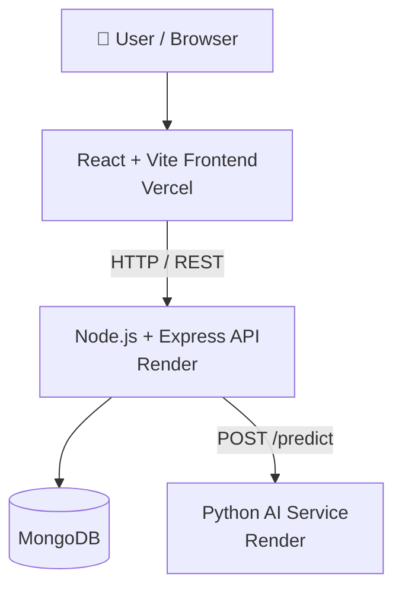

<div align="center">

# 🛡️ ToxicGuard

### Detect toxic speech. Promote safer conversations.

A full-stack, AI-assisted toxic speech detection platform with secure authentication, custom banned words, passkey login, and per-user analysis history.

[](https://toxic-guard-iota.vercel.app/)
[](https://toxicguard-api-k87a.onrender.com/)
[](https://toxicguard-ai-5u8m.onrender.com/)


[Live Demo](https://toxic-guard-iota.vercel.app/) · [Report a Bug](https://github.com/HarshitRaj31/ToxicGuard/issues) · [Request a Feature](https://github.com/HarshitRaj31/ToxicGuard/issues)

</div>

---

## 📑 Table of Contents

- [About](#-about)
- [Live Demo](#-live-demo)
- [Features](#-features)
- [Tech Stack](#-tech-stack)
- [Architecture](#-architecture)
- [Project Structure](#-project-structure)
- [Getting Started](#-getting-started)
- [Environment Variables](#-environment-variables)
- [API Reference](#-api-reference)
- [Deployment](#-deployment)
- [Troubleshooting](#-troubleshooting)
- [Security](#-security)
- [Roadmap](#-roadmap)
- [Contributing](#-contributing)
- [Author](#-author)
- [License](#-license)

---

## 📖 About

**ToxicGuard** analyzes user-submitted text and flags potentially harmful language. It combines a **React + Vite** frontend, a **Node.js + Express** API, a dedicated **Python AI service**, and **MongoDB** for persistence.

Each submission first passes through **custom banned-word rules**. If none match, the text is sent to the AI model, which returns a classification, confidence score, and detected labels. Results are saved per user so they can be reviewed later.

## 🌐 Live Demo

| Service | URL |
|---|---|
| 🖥️ Frontend | https://toxic-guard-iota.vercel.app/ |
| ⚙️ Backend API | https://toxicguard-api-k87a.onrender.com/ |
| 🤖 AI Service | https://toxicguard-ai-5u8m.onrender.com/ |

> ⏳ **Note:** Services on Render's free tier spin down when idle. The first request may take 30–60 seconds while they wake up.

## ✨ Features

- 🔍 **Toxic speech detection** — text analysis powered by a Python AI service
- 🏷️ **Classification with confidence** — category, confidence score, and detected labels for every result
- 🚫 **Custom banned words** — define your own restricted terms that are checked before the AI runs
- 🔐 **User authentication** — JWT-based auth with protected routes
- 🔑 **Passkey support** — passwordless / two-factor login via WebAuthn
- 📜 **Analysis history** — searchable record of past analyses tied to each user
- 📊 **Dashboards** — stats and analytics for users and admins
- 🧾 **Activity logging** — records relevant user activity for admins
- 📱 **Responsive interface** — works across desktop and mobile browsers

## 🧰 Tech Stack

| Layer | Technology |
|---|---|
| **Frontend** | React, Vite, React Router, Axios |
| **Backend** | Node.js, Express.js |
| **Database** | MongoDB, Mongoose |
| **AI Service** | Python |
| **Authentication** | JWT, WebAuthn (SimpleWebAuthn) |
| **Hosting** | Vercel (frontend), Render (backend + AI) |
| **Tooling** | Git, GitHub |

## 🏗️ Architecture



### How an analysis works

1. The user submits text through the frontend.
2. The frontend sends an authenticated request to the Node.js API.
3. The backend checks the text against the user's **custom banned words**.
4. If nothing matches, the backend forwards the text to the **Python AI service**.
5. The AI service returns a classification, confidence score, and detected labels.
6. The backend saves the successful analysis to **MongoDB**.
7. The frontend displays the result and can retrieve the user's **history**.

## 📁 Project Structure

```text
ToxicGuard/
├── client/                 # React + Vite frontend
├── server/                 # Node.js + Express backend
│   ├── models/             # Mongoose models
│   ├── routes/             # API routes
│   ├── middleware/         # Auth and other middleware
│   ├── app.js
│   └── server.js
├── ai-service/             # Python AI service
├── README.md
└── .gitignore
```

> Adjust folder names to match your repository layout.

## ⚙️ Getting Started

### Prerequisites

- [Node.js](https://nodejs.org/) and npm
- [Python](https://www.python.org/) 3.x and pip
- [MongoDB](https://www.mongodb.com/) locally, or a [MongoDB Atlas](https://www.mongodb.com/atlas) cluster
- [Git](https://git-scm.com/)

### 1. Clone the repository

```bash
git clone https://github.com/HarshitRaj31/ToxicGuard.git
cd ToxicGuard
```

### 2. Start the Python AI service

```bash
cd ai-service
pip install -r requirements.txt
# start with the command defined in your Python app (port 8000 is assumed below)
```

The service must expose a `/predict` endpoint that accepts text and returns JSON compatible with the backend.

### 3. Start the backend

```bash
cd server
npm install
```

Create `server/.env`:

```env
PORT=5000
MONGO_URI=your_mongodb_connection_string
JWT_SECRET=your_secure_jwt_secret
CLIENT_URL=http://localhost:5173
AI_SERVICE_URL=http://127.0.0.1:8000
WEBAUTHN_RP_ID=localhost
WEBAUTHN_ORIGIN=http://localhost:5173
```

```bash
npm start
```

### 4. Start the frontend

```bash
cd client
npm install
```

Create `client/.env`:

```env
VITE_API_URL=http://localhost:5000/api
```

```bash
npm run dev
```

Vite prints the local URL (usually `http://localhost:5173`).

## 🔐 Environment Variables

### Frontend (Vercel)

| Variable | Description |
|---|---|
| `VITE_API_URL` | Base URL of the Node.js API, including `/api` |

### Backend (Render)

| Variable | Description |
|---|---|
| `PORT` | Server port (Render sets this automatically) |
| `MONGO_URI` | MongoDB connection string |
| `JWT_SECRET` | Secret used to sign JWTs |
| `CLIENT_URL` | Allowed frontend origin for CORS |
| `AI_SERVICE_URL` | Base URL of the Python AI service |
| `WEBAUTHN_RP_ID` | WebAuthn relying-party domain |
| `WEBAUTHN_ORIGIN` | Expected frontend origin for WebAuthn |

<details>
<summary><b>Production values</b></summary>

```env
# Frontend
VITE_API_URL=https://toxicguard-api-k87a.onrender.com/api

# Backend
CLIENT_URL=https://toxic-guard-iota.vercel.app
AI_SERVICE_URL=https://toxicguard-ai-5u8m.onrender.com
WEBAUTHN_RP_ID=toxic-guard-iota.vercel.app
WEBAUTHN_ORIGIN=https://toxic-guard-iota.vercel.app
```

</details>

> ⚠️ **Never commit `.env` files, database credentials, or JWT secrets.** Add `.env` to `.gitignore` and set production secrets in your hosting provider's dashboard.

## 🔌 API Reference

| Route prefix | Purpose |
|---|---|
| `/api/auth` | Registration, login, password reset |
| `/api/analysis` | Text analysis, history, stats |
| `/api/custom-words` | Manage custom banned words |
| `/api/users` | User management |
| `/api/activity` | Activity logs |
| `/api/face` | Face enrollment / verification |
| `/api/passkeys` | Passkey (WebAuthn) registration and login |

### Example: analyze text

**Request** (authentication required)

```http
POST /api/analysis
Content-Type: application/json
Authorization: Bearer <your-token>
```

```json
{
  "comment": "Text to analyze"
}
```

**Response** — the saved analysis record, including:

| Field | Description |
|---|---|
| `comment` | The submitted text |
| `result` | Overall classification result |
| `category` | Assigned category |
| `confidence` | Model confidence score |
| `detectedLabels` | Labels detected in the text |
| `createdAt` | Timestamp of the analysis |

> Exact labels depend on the AI model and backend mapping. Methods and permissions vary by route.

## 🚀 Deployment

<details>
<summary><b>Frontend — Vercel</b></summary>

1. Import the repository into Vercel.
2. Set the root directory to `client`.
3. Add `VITE_API_URL` to the environment variables.
4. Deploy.

</details>

<details>
<summary><b>Backend — Render</b></summary>

1. Create a Node.js web service on Render.
2. Set the root directory to `server` and the start command (e.g. `npm start`).
3. Add all backend environment variables.
4. Confirm the service connects to MongoDB and responds on its health endpoint.

</details>

<details>
<summary><b>AI Service — Render</b></summary>

1. Create a Python web service on Render.
2. Set the root directory to `ai-service`, plus the build and start commands.
3. Confirm `/predict` responds correctly.
4. Set `AI_SERVICE_URL` on the backend to this service's URL.

</details>

## 🧪 Troubleshooting

| Problem | What to check |
|---|---|
| **Analysis returns HTTP 500** | Backend logs. The failure may be in the AI request, the database save, or another operation. |
| **AI service returns 502 / 503** | Service status, deployment events, logs, and the `/predict` endpoint. If the AI call fails, no record is saved. |
| **Analysis history is empty** | That the analysis saved successfully, the record's `user` matches the logged-in user, and the frontend calls the right history endpoint. |
| **CORS errors** | `CLIENT_URL` must exactly match the deployed frontend origin. |
| **Passkeys fail** | `WEBAUTHN_RP_ID` and `WEBAUTHN_ORIGIN` must match the domain and origin you are using. |
| **First request is slow** | Render free-tier services sleep when idle; wait for them to wake up. |

## 🔒 Security

- Keep credentials and secrets out of version control
- Require authentication on protected API routes
- Validate and limit incoming text length
- Serve all deployed services over HTTPS
- Avoid logging sensitive user information
- Restrict admin endpoints to authorized users

## 🛣️ Roadmap

- [ ] Improve classification accuracy and model evaluation
- [ ] Add monitoring and health checks for the AI service
- [ ] Add automated tests for API endpoints
- [ ] Add pagination and filtering to analysis history
- [ ] Improve error reporting
- [ ] Optimize inference latency and database queries

## 🤝 Contributing

Contributions, issues, and feature requests are welcome.

1. Fork the repository
2. Create a branch: `git checkout -b feature/your-feature`
3. Commit your changes: `git commit -m "Add your feature"`
4. Push the branch: `git push origin feature/your-feature`
5. Open a Pull Request

## 👨‍💻 Author

**Harshit Raj**

[](https://github.com/HarshitRaj31)

## 📄 License

This project is licensed under the **MIT License**. See the [LICENSE](LICENSE) file for details.

> If you choose a different license, update this section and add the matching `LICENSE` file.

---

<div align="center">

*Built to support safer digital conversations through AI-assisted toxic speech detection.*

⭐ If you found this project useful, consider giving it a star!

</div>
